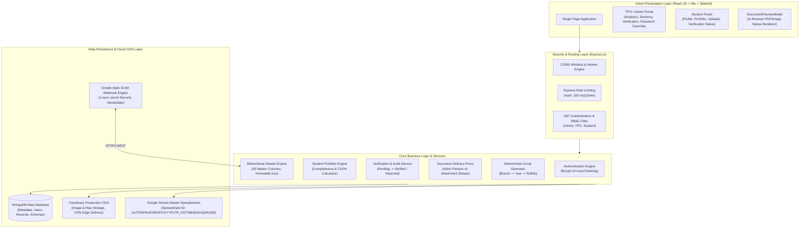
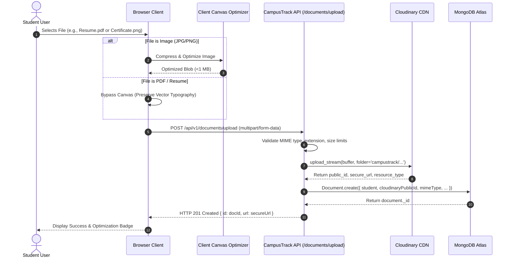
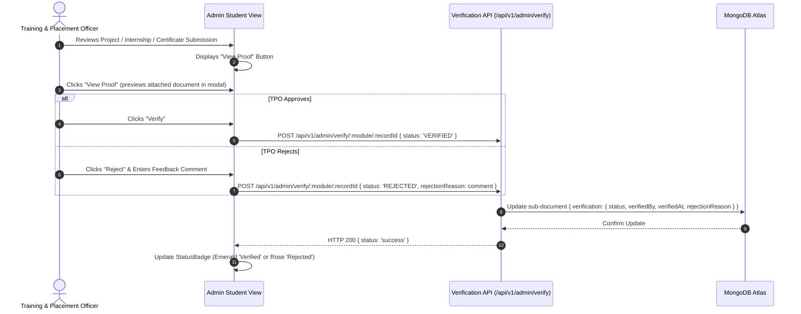
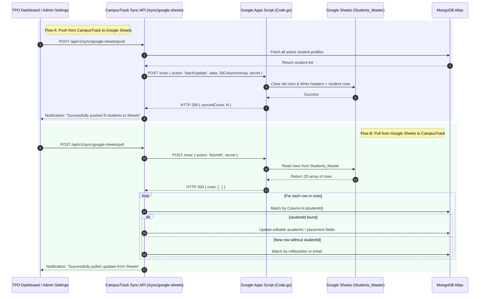

# CampusTrack v1.0 — System Architecture & Engineering Specification

**Document Version:** 1.0.0  
**Status:** Production Ready  
**Target Audience:** Engineering, Placement Directors, TPO Administrators, Enterprise Auditors  
**System Name:** CampusTrack (Placement, Portfolio & Institutional Document Management System)

---

## 1. Executive Summary & Research Foundation

### 1.1 Problem Statement & Background
Higher education placement ecosystems operate under severe administrative bottlenecks:
1. **Fragmented Student Profiles:** Academic marks, arrears/backlogs, personal records, and technical portfolios exist scattered across offline spreadsheets, legacy portals, and paper forms.
2. **Document Chaos & Uncontrolled Storage:** Resumes, internship certificates, and course credentials are submitted in varied resolutions and formats, resulting in storage bloat, inaccessible links, or automated downloads that disrupt review efficiency.
3. **Lack of In-Browser Document Inspection:** Conventional campus portals force downloads of PDFs/images onto administrative workstations whenever a document link is clicked, creating local storage pollution and security vulnerabilities.
4. **Desynchronized Corporate Spreadsheets:** Placement cells rely heavily on Google Sheets and Excel for corporate recruiting drives. Manually exporting and re-uploading CSVs creates data drift, accidental row deletions, and outdated student statistics.
5. **Verification Integrity Deficits:** TPOs require definitive proof verification workflows (accept/reject with structured feedback) before student credentials appear in official placement brochures.

### 1.2 The CampusTrack Solution
CampusTrack is an enterprise-grade web application engineered to unify student portfolio tracking, administrative verification, secure Cloudinary file storage, and real-time bidirectional Google Sheets synchronization.

---

## 2. High-Level System Architecture

CampusTrack adopts a **Layered Micro-Modular Architecture** separating presentation, API routing, business logic, persistence, and external cloud infrastructure.



---

## 3. Core Architectural Subsystems

### Subsystem A: Authentication, RBAC & Security Override
- **JWT Authentication:** Stateless, digitally signed tokens containing user `id`, `role`, and expiration timestamp. Tokens are stored in browser `localStorage` and passed either via `Authorization: Bearer <token>` or query parameter `?token=<jwt>` for native browser iframe embedding.
- **Role Isolation:** Strict role-based middleware (`protect`, `restrictTo('admin', 'tpo')`) ensures students cannot modify verification states, alter backlogs, reset other students' passwords, or access other students' private documents.
- **TPO Password Reset Override:** Placement officers can securely reset student passwords directly from the student view without accessing previous credentials. Passwords are salted and hashed using **bcrypt (10 rounds)** in MongoDB Atlas.

### Subsystem B: Student Academic Portfolio & Multi-Module Architecture
Students track ten granular modules:
1. **Personal & Contact:** Email, phone, alternate mobile, gender, student ID.
2. **Parent / Guardian:** Father, mother names and contact numbers.
3. **Permanent Address:** Door no, street, city, district, state, pincode.
4. **Academic Track Record:** 10th (SSC) %, Intermediate/Diploma %, current CGPA, number of active backlogs, batch year, current semester.
5. **Projects:** Title, category, tech stack, personal role, repository URL, and verification proof.
6. **Internships:** Organization, role, tenure, monthly stipend, completion certificate, offer letter.
7. **Certifications:** Course title, issuing authority, credential ID, issue date, certificate PDF/image.
8. **NPTEL Courses:** Course title, certification type (Elite, Silver, Gold), exam score, completion certificate.
9. **Hackathons:** Event title, organizing entity, project synopsis, position secured, certificate proof.
10. **Coding Platforms:** LeetCode, CodeChef, HackerRank, Codeforces, GitHub handles, problem counts, and ratings.

### Subsystem C: Production File Storage & Cloudinary Pipeline
To ensure high performance and low bandwidth consumption:
- **Client-Side Canvas Optimization:** Profile photos and image certificates are resized and converted to compressed WebP/JPEG format on a browser HTML5 Canvas before transmission, reducing file weight by **60% to 85%**.
- **Vector Typography Preservation:** Resumes and academic PDFs **completely bypass canvas optimization** to preserve vector text, searchability, and print fidelity.
- **Cloudinary Buffer Streaming:** Uploads are received into memory (`multer.memoryStorage()`) and piped directly to Cloudinary using `cloudinary.uploader.upload_stream` with folder taxonomy:
  - `campustrack/profile_photos/`
  - `campustrack/resumes/`
  - `campustrack/certificates/`
  - `campustrack/proofs/`
- **Metadata Separation:** Binary blobs exist solely on Cloudinary CDN. MongoDB Atlas stores only document metadata, file size, MIME type, Cloudinary public ID, and secure delivery URLs.

### Subsystem D: Online Document Viewing vs. Explicit Download
- **The Problem:** Cloudinary raw URLs return `Content-Disposition: attachment`, prompting browsers to download files automatically rather than previewing them.
- **The Solution:** The backend document controller acts as an authenticated delivery proxy:
  - **Online Preview Action (`GET /api/v1/documents/:id?token=...`)**:
    - Response Header: `Content-Disposition: inline; filename="..."`
    - Response Header: `Content-Type: application/pdf` (or `image/png`, `image/jpeg`)
    - Document opens inside `DocumentPreviewModal` with an embedded `<iframe>` native PDF viewer or zoomable image container.
  - **Explicit Download Action (`GET /api/v1/documents/:id?token=...&download=true`)**:
    - Response Header: `Content-Disposition: attachment; filename="..."`
    - Forces the browser to initiate a file save operation directly to local disk.

### Subsystem E: Bidirectional Google Sheets & Excel Synchronization
- **Master Sheet ID:** `1w2T9SHihyIOdKWXCkYYPu7R_U2ZYqB3j4zhrQjXKQBk` (`Students_Master`)
- **Immutable Sync Key:** Column A contains `studentId` (MongoDB `_id`). This immutable key anchors every student record across both databases.
- **30 Standardized Columns:** Deterministic mapping covering identification, contact, academics, address, placement details, and sync timestamps.
- **Security Handshake:** Google Apps Script (`Code.gs`) communicates with CampusTrack via HTTPS using header `x-sync-secret: campustrack_sync_secret_prod_987654321`. Raw database credentials are never stored in Google Sheets.
- **Deterministic Excel Sorting:** Corporate placement reports exported from CampusTrack are sorted deterministically: `Branch ASC` &rarr; `Year ASC` &rarr; `Roll Number ASC`.

---

## 4. End-to-End System Flow Diagrams

### 4.1 Student Document Upload & Cloudinary Ingestion Flow



---

### 4.2 TPO Document Viewing (Preview vs Explicit Download) Flow

```mermaid
sequenceDiagram
    autonumber
    actor TPO as Training & Placement Officer
    participant Browser as TPO Browser UI
    participant Modal as DocumentPreviewModal
    participant Backend as Document Controller (/api/v1/documents/:id)
    participant Cloudinary as Cloudinary CDN Edge

    TPO->>Browser: Opens Student Profile
    alt TPO clicks "View Resume" / "View Certificate"
        Browser->>Modal: Open DocumentPreviewModal(docId, title)
        Modal->>Backend: GET /api/v1/documents/:id?token=<JWT> (disposition=inline)
        Backend->>Backend: Verify JWT Token & RBAC Access
        Backend->>Cloudinary: Fetch Document Stream
        Cloudinary-->>Backend: Binary Stream
        Backend-->>Modal: Stream with Content-Disposition: inline & Content-Type: application/pdf
        Modal->>Modal: Render in native browser <iframe> viewer
        Modal-->>TPO: Interactive In-Browser Document Preview
    else TPO clicks "Download"
        Browser->>Backend: GET /api/v1/documents/:id?token=<JWT>&download=true
        Backend->>Backend: Verify JWT Token & RBAC Access
        Backend->>Cloudinary: Fetch Document Stream
        Cloudinary-->>Backend: Binary Stream
        Backend-->>Browser: Stream with Content-Disposition: attachment; filename="Roll_Resume.pdf"
        Browser-->>TPO: Native Save-to-Disk Dialog
    end
```

---

### 4.3 TPO Portfolio Record Verification Flow



---

### 4.4 Google Sheets Two-Way Synchronization Flow



---

## 5. Database Schema & Data Models

### 5.1 Document Schema (`Document.ts`)
```typescript
interface IDocument {
  _id: mongoose.Types.ObjectId;
  student: mongoose.Types.ObjectId;        // Reference to Student model
  uploadedBy: mongoose.Types.ObjectId;     // Reference to User model
  documentType: 
    | 'profile_photo' 
    | 'resume' 
    | 'certificate' 
    | 'offer_letter' 
    | 'proof_document' 
    | 'other';
  filename: string;                        // Stored unique filename
  originalName: string;                    // Client original filename
  mimeType: string;                        // e.g. application/pdf, image/png
  size: number;                            // File size in bytes
  originalSize?: number;                   // Pre-optimization size
  optimizedSize?: number;                  // Post-optimization size
  cloudinaryPublicId?: string;             // Cloudinary asset ID
  cloudinaryUrl?: string;                  // Cloudinary HTTP URL
  cloudinarySecureUrl?: string;            // Cloudinary HTTPS CDN URL
  cloudinaryResourceType?: string;         // 'image' | 'raw'
  status: 'active' | 'deleted';
  createdAt: Date;
  updatedAt: Date;
}
```

### 5.2 Student Profile Schema (`Student.ts`)
```typescript
interface IStudent {
  _id: mongoose.Types.ObjectId;
  user: mongoose.Types.ObjectId;           // Reference to User
  rollNumber: string;                      // Unique index, e.g. 21B91A0501
  fullName: string;
  email: string;                           // Unique index
  studentMobile?: string;
  gender?: 'Male' | 'Female' | 'Other';
  branch: string;                          // CSE, ECE, IT, MECH, CIVIL, AIDS, AIML
  year: number;                            // 1, 2, 3, 4
  semester: number;                        // 1 to 8
  batch: string;                           // e.g. 2021-2025
  cgpa: number;                            // e.g. 8.45
  numberOfBacklogs: number;                // Active backlogs count
  profilePhoto?: string;                   // Cloudinary secure URL
  resumeLink?: string;                     // /api/v1/documents/:id or Cloudinary URL
  address: {
    doorNo?: string;
    street?: string;
    city?: string;
    district?: string;
    state?: string;
    pincode?: string;
  };
  semesterResults: Array<{
    semester: number;
    percentage: number;
    sgpa?: number;
  }>;
  profileCompletion: number;               // Auto-calculated 0 to 100%
  placementStatus: 'UNPLACED' | 'PLACED' | 'OPTED_OUT';
  placementDetails?: {
    companyName: string;
    packageLPA: number;
    offerDate: Date;
  };
}
```

### 5.3 Verification Sub-Schema (`VerificationSchema`)
Applied uniformly to `Project`, `Internship`, `Certification`, `NPTELRecord`, `Hackathon`, and `Achievement`:
```typescript
const verificationSchema = new mongoose.Schema({
  status: {
    type: String,
    enum: ['PENDING', 'VERIFIED', 'REJECTED'],
    default: 'PENDING',
  },
  verifiedBy: { type: mongoose.Schema.Types.ObjectId, ref: 'User' },
  verifiedAt: { type: Date },
  rejectionReason: { type: String, trim: true },
});
```

---

## 6. REST API Interface Catalog

| Method | Endpoint | Description | Auth Required | Permissions |
| :--- | :--- | :--- | :--- | :--- |
| `POST` | `/api/v1/auth/login` | User authentication with rate limiting | No | Public |
| `POST` | `/api/v1/auth/register` | Student initial registration | No | Public |
| `GET` | `/api/v1/auth/me` | Fetch active authenticated user profile | Yes | Any valid role |
| `GET` | `/api/v1/students/me` | Fetch detailed student record & portfolio | Yes | Student owner |
| `PUT` | `/api/v1/students/me` | Update student profile & personal data | Yes | Student owner |
| `POST` | `/api/v1/documents/upload` | Upload file to Cloudinary & record metadata | Yes | Any valid role |
| `GET` | `/api/v1/documents/:id` | **Online Document Preview (inline disposition)** | Token / Bearer | Owner / Admin / TPO |
| `GET` | `/api/v1/documents/:id?download=true` | **Explicit File Download (attachment disposition)** | Token / Bearer | Owner / Admin / TPO |
| `GET` | `/api/v1/documents/student/:studentId/resume` | Direct resume preview / download | Token / Bearer | Owner / Admin / TPO |
| `GET` | `/api/v1/admin/dashboard` | TPO dashboard KPIs, stats, live feed | Yes | Admin / TPO |
| `GET` | `/api/v1/admin/students` | Student Directory with search, filters, pagination | Yes | Admin / TPO |
| `GET` | `/api/v1/admin/students/:id` | Full populated student profile & credentials | Yes | Admin / TPO |
| `POST` | `/api/v1/admin/students/:id/change-password` | TPO Student Password Override | Yes | Admin / TPO |
| `POST` | `/api/v1/admin/verify/:module/:id` | Approve or Reject student credential with notes | Yes | Admin / TPO |
| `GET` | `/api/v1/exports/students/excel` | Export deterministically sorted corporate Excel | Yes | Admin / TPO |
| `POST` | `/api/v1/sync/google-sheets/push` | Trigger batch push to Google Sheets master | Yes | Admin / TPO |
| `POST` | `/api/v1/sync/google-sheets/pull` | Trigger two-way sync pull from Google Sheets | Yes | Admin / TPO |
| `POST` | `/api/v1/sync/google-sheets/webhook` | Webhook receiver for Google Apps Script edits | Secret Header | Google Apps Script |

---

## 7. Security, Privacy & Quality Architecture

1. **Defense in Depth:**
   - Helmet HTTP headers (`Cross-Origin-Resource-Policy: cross-origin` for document streams).
   - Rate limiting on authentication routes (100 requests per 15-minute window per IP).
   - Input sanitization via Zod schemas and Mongoose validators.
2. **Document Access Security:**
   - Private student documents (resumes, offer letters, proofs) reject unauthorized requests with `401 Unauthorized` or `403 Forbidden`.
   - Temporary signed tokens enable previewing inside sandboxed `<iframe>` viewers without exposing long-lived credentials.
   - Profile photos remain accessible for directory avatars without compromising private academic PDFs.
3. **Audit Trails:**
   - Every verification, rejection feedback note, password override, and synchronization operation records `updatedBy` and timestamp audit entries.

---

## 8. Technology Stack Specification

| Tier | Technology | Version | Purpose |
| :--- | :--- | :--- | :--- |
| **Frontend UI** | React | `^18.2.0` | Reactive component-based single-page application |
| **Build Tool** | Vite | `^5.2.11` | Hot module replacement & production bundling |
| **Styling** | Tailwind CSS | `^3.4.3` | Tailored utility-first responsive styling system |
| **Icons** | Lucide React | `^0.378.0` | Comprehensive vector interface iconography |
| **Charts** | Recharts | `^2.12.7` | SVG interactive placement analytics & distribution charts |
| **Backend Runtime** | Node.js | `>=20.x` | High-throughput asynchronous server runtime |
| **Framework** | Express.js | `^4.19.2` | REST API routing and middleware pipeline |
| **Database** | MongoDB Atlas | `>=7.0` | Cloud document database with clustering & indexes |
| **ODM** | Mongoose | `^8.3.1` | Strictly typed schema models and data validation |
| **Cloud Storage** | Cloudinary | `^2.11.0` | Managed cloud asset storage & global CDN delivery |
| **Spreadsheet Sync** | Google Apps Script | V8 Engine | Webhook-driven synchronization with Google Sheets |
| **Excel Generation** | ExcelJS | `^4.4.0` | Programmatic corporate spreadsheet generation |
