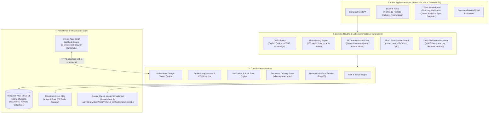
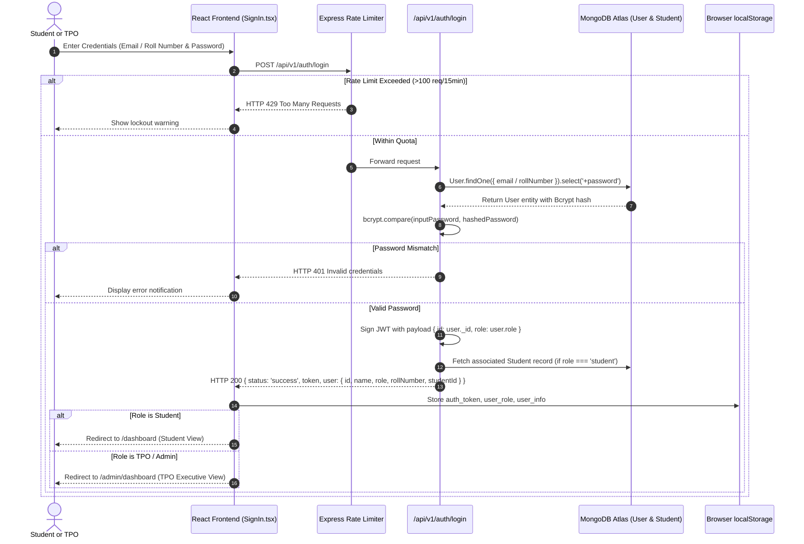
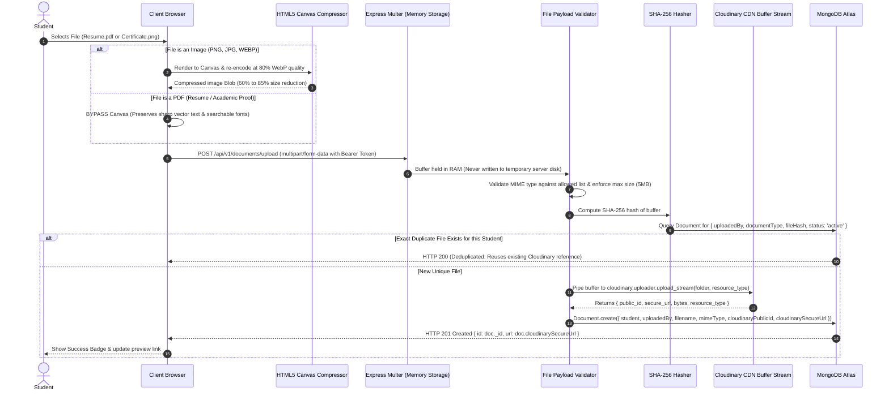
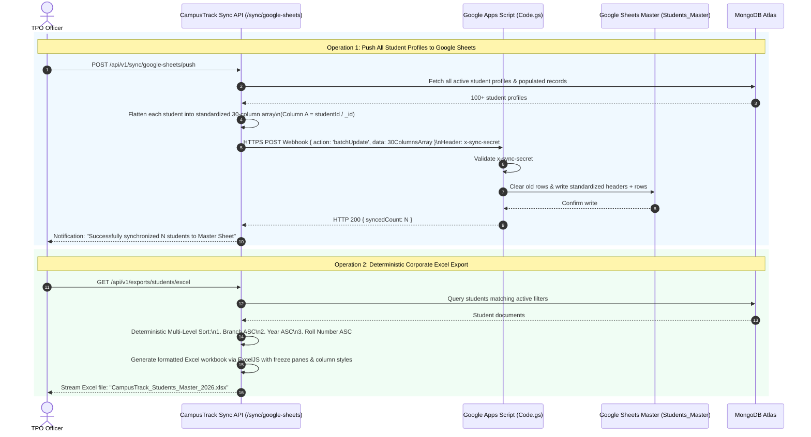
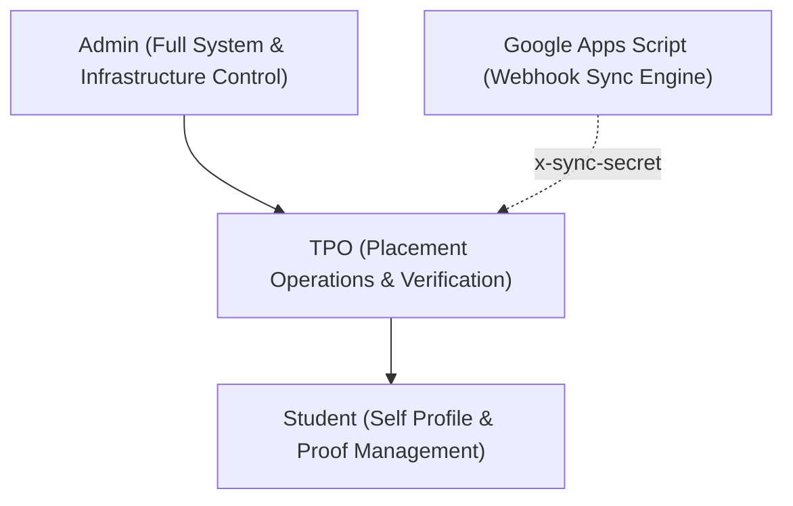

# CampusTrack — Complete Campus Portal, RBAC & Security Engineering Specification

This document provides a thorough, unified breakdown of the **CampusTrack** institutional portal. It explains the system flows, operational lifecycles, Role-Based Access Control (RBAC) matrix, and deep security architecture with defense-in-depth mitigations.

---

## 1. The Campus Portal Concept: Why It Exists & Core Actors

### 1.1 The Operational Bottleneck in Higher Education
In traditional college placement and training ecosystems, student information and credentials exist in a fragmented, uncontrolled state:
- **Scattered Data:** Marks, backlogs, personal contact information, and achievements reside in disconnected spreadsheets, physical paperwork, and disparate departmental emails.
- **Unverified Resumes & Claims:** Students often claim projects, internships, or high NPTEL scores on resumes without verifiable administrative proof. Placement cells spend weeks manually validating paper certificates before corporate recruiters arrive.
- **Document Management Chaos:** Resumes and certificates uploaded to free or unconfigured cloud storage trigger forced browser downloads on administrative workstations, polluting local disks and exposing private student records.
- **Dual-Database Desynchronization:** Placement cells routinely use Google Sheets for day-to-day operations and company shortlisting, while IT uses a SQL/NoSQL database. Manual CSV uploads cause data drift, overwritten columns, and stale statistics.

### 1.2 The CampusTrack Vision
CampusTrack solves this by unifying **student academic portfolio management**, **proof-based credential verification**, **secure in-browser document streaming**, and **bidirectional Google Sheets synchronization** into a single cohesive platform.

### 1.3 System Actors & Personas

| Actor | Persona Description | Core Motivations & Access Level |
| :--- | :--- | :--- |
| **Student** | Enrolled undergraduate/postgraduate candidate | Build profile, maintain portfolio (projects, internships, NPTEL, coding handles), upload verifiable proofs, track verification status, monitor placement announcements. Strictly isolated to their own records. |
| **TPO (Training & Placement Officer)** | Institutional placement cell officer | Inspect student portfolios, preview uploaded proofs directly in the browser, accept/reject credentials with structured feedback, manage placement eligibility, broadcast company announcements, trigger master spreadsheet sync. |
| **Placement Admin** | Senior system/placement administrator | Full supervisory authority. Supercharges TPO privileges with batch student promotions, semester updates, emergency password overrides, storage analytics, and deterministic corporate Excel generation. |
| **External Sync (Google Apps Script)** | Automated service running in Google Cloud | Bidirectionally pushes/pulls master spreadsheet data to keep the placement cell's Google Sheets in real-time alignment with MongoDB Atlas. |
| **Corporate Recruiter (Auditor)** | External corporate talent scout / placement auditor | Receives verified, deterministic Excel sheets formatted strictly by `Branch -> Year -> Roll Number`, containing only verified student stats. |

---

## 2. High-Level Architecture & Component Interaction



---

## 3. End-to-End System Flows

### Flow 1: Authentication, Session Initialization & RBAC Context Propagation



---

### Flow 2: Student Profile & Multi-Module Academic Portfolio Lifecycle

The student portfolio is split into ten granular, independently managed sub-modules to prevent massive, monolithic form submissions:

```mermaid
flowchart LR
    subgraph StudentProfileModules ["Student Portfolio Modules"]
        M1["1. Personal & Contact"]
        M2["2. Academic Track (10th/12th/CGPA/Backlogs)"]
        M3["3. Projects (GitHub, Stack, Role, Proof)"]
        M4["4. Internships (Company, Stipend, Offer/Certificate)"]
        M5["5. Certifications (Authority, Credential ID, Proof)"]
        M6["6. NPTEL Records (Elite/Gold/Silver, Score, Certificate)"]
        M7["7. Hackathons (Organizer, Rank, Proof)"]
        M8["8. Coding Profiles (LeetCode, HackerRank, CodeChef, GitHub)"]
        M9["9. Achievements (Awards, Extracurriculars)"]
        M10["10. Resume & Profile Photo"]
    end

    subgraph Engine ["Completeness Calculation Engine"]
        Calc["profileCompletion.ts\n(Weighted scoring across modules: 0% to 100%)"]
    end

    subgraph State ["Student State in Database"]
        DBRecord[("Student Document in MongoDB Atlas")]
    end

    StudentProfileModules --> Calc
    Calc --> DBRecord
```



#### Profile Completeness Formula
The profile completion algorithm evaluates completeness across critical dimensions:
- **Core Academics & Contact:** Full name, roll number, email, phone, gender, branch, year, semester, CGPA, backlogs (Weight: 35%).
- **Resume & Identification:** Uploaded active resume document link and profile photo (Weight: 20%).
- **Verified Portfolio Proofs:** At least 1 verified project, 1 internship or certification, and competitive coding handles (Weight: 45%).
- Students with `< 75%` profile completeness are flagged on the TPO dashboard as *Action Required* before placement season shortlists are finalized.

---

### Flow 3: Document Ingestion, Optimization & Cloudinary Pipeline

Uploading files securely without crashing the server, running out of disk space, or storing massive uncompressed images:



---

### Flow 4: In-Browser Document Preview vs Forced Download Mechanism

One of the most critical UX and security innovations in CampusTrack is resolving the **Cloudinary Raw Download Problem**:

- **The Problem:** Cloudinary serves raw PDF and attachment files with HTTP header `Content-Disposition: attachment; filename="..."`. This causes the browser to forcefully download the PDF onto the user's hard drive instead of letting the user review it in-browser.
- **The Solution:** The CampusTrack backend acts as an authenticated **Streaming Delivery Proxy**:

```mermaid
sequenceDiagram
    autonumber
    actor TPO as Placement Officer (TPO)
    participant UI as TPO UI (AdminStudentView)
    participant Modal as DocumentPreviewModal (React)
    participant Proxy as Express Document Proxy (/api/v1/documents/:id)
    participant Cloudinary as Cloudinary Cloud CDN

    TPO->>UI: Clicks "View Proof" or "View Resume"
    UI->>Modal: Open modal with document ID & title
    Modal->>Proxy: GET /api/v1/documents/:id?token=<JWT>
    Proxy->>Proxy: Authenticate User (Bearer header or query ?token=)
    Proxy->>Proxy: Verify Access Rights (Owner OR TPO/Admin)
    alt Requested Preview (Default: isDownload=false)
        Proxy->>Cloudinary: HTTPS GET upstream asset stream
        Cloudinary-->>Proxy: Binary chunk stream
        Proxy-->>Modal: Stream response with:\nContent-Disposition: inline\nContent-Type: application/pdf (or image/png)
        Modal->>Modal: Render inside native browser <iframe> without downloading to disk
        Modal-->>TPO: Interactive In-Browser Inspection
    else Requested Explicit Download (isDownload=true)
        Proxy->>Cloudinary: HTTPS GET upstream asset stream
        Cloudinary-->>Proxy: Binary chunk stream
        Proxy-->>UI: Stream response with:\nContent-Disposition: attachment; filename="StudentRoll_Proof.pdf"
        UI-->>TPO: Trigger native browser Save-As dialog
    end
```

---

### Flow 5: TPO Verification & Proof Audit Lifecycle

Every project, internship, certification, hackathon, and NPTEL record must undergo explicit administrative audit:

```mermaid
stateDiagram-v2
    [*] --> PENDING: Student submits portfolio record with proof document
    
    state PENDING {
        [*] --> InReview: TPO opens record
        InReview --> ProofInspected: TPO clicks "View Proof" (streams in DocumentPreviewModal)
    }

    ProofInspected --> VERIFIED: TPO clicks "Verify" (Valid proof confirmed)
    ProofInspected --> REJECTED: TPO clicks "Reject" (Fake / invalid / illegible proof)

    state VERIFIED {
        note right of VERIFIED
            Record displays Green Emerald Badge.
            Record is unlocked for corporate Excel export.
            Student cannot edit record unless unverified.
        end note
    }

    state REJECTED {
        note right of REJECTED
            Record displays Red Rose Badge.
            rejectionReason recorded in DB.
            Student receives feedback note to re-upload.
        end note
    }

    REJECTED --> PENDING: Student uploads corrected document proof
```

---

### Flow 6: Bidirectional Google Sheets & Deterministic Excel Export

Placement officers rely on Google Sheets during live interview rounds. CampusTrack provides automated bidirectional synchronization and deterministic corporate Excel generation:



---

## 4. Role-Based Access Control (RBAC) Architecture

CampusTrack enforces a strict, hierarchical Role-Based Access Control model backed by Express middleware:

### 4.1 Role Hierarchy & Permissions Matrix



| Feature / Resource Route | Student Role | TPO Role | Admin Role | Security Checkpoint |
| :--- | :---: | :---: | :---: | :--- |
| **Login / Register** | Allow | Allow | Allow | Public, Rate-Limited (100 req/15min) |
| **View Own Student Profile** | Allow | Allow | Allow | `protect`, Owner check |
| **Update Own Profile Data** | Allow | Deny | Deny | `protect`, Student context |
| **Upload Proof Document** | Allow | Allow | Allow | `protect`, Multer memory storage |
| **View Student Profile Photo** | Public | Public | Public | Public CDN image asset |
| **View Own Private Documents** | Allow | Allow | Allow | `protect`, Owner check |
| **View Other Student's Resume** | **DENIED (403)** | Allow | Allow | `protect`, `restrictTo('admin', 'tpo')` or Direct Owner |
| **Verify / Reject Student Proofs**| **DENIED (403)** | Allow | Allow | `protect`, `restrictTo('admin', 'tpo')` |
| **Override Student Password** | **DENIED (403)** | Allow | Allow | `protect`, `restrictTo('admin', 'tpo')` |
| **Export Corporate Excel** | **DENIED (403)** | Allow | Allow | `protect`, `restrictTo('admin', 'tpo')` |
| **Push/Pull Google Sheets** | **DENIED (403)** | Allow | Allow | `protect`, `restrictTo('admin', 'tpo')` |
| **Webhook Sync Receiver** | Deny | Deny | Deny | Validated via `x-sync-secret` header |
| **Batch Promote Semesters** | **DENIED (403)** | Deny | Allow | `protect`, `restrictTo('admin')` |
| **View Global Audit Logs** | **DENIED (403)** | Allow | Allow | `protect`, `restrictTo('admin', 'tpo')` |

### 4.2 Middleware Implementation Mechanics

1. **`protect` Middleware ([server/src/middlewares/auth.ts](file:///d:/Projects%20June/CampusTrack/CampusTrack/server/src/middlewares/auth.ts)):**
   - Extracts the JWT token from `Authorization: Bearer <token>` header or `?token=<jwt>` query parameter.
   - Decodes the token using the institutional secret key.
   - Queries MongoDB to ensure the user still exists and has not been deactivated.
   - Attaches `req.user = { id, role, rollNumber, email }` to the Express request context.

2. **`restrictTo(...roles)` Middleware:**
   - Evaluates `req.user.role`.
   - Intercepts requests where the role is not included in the allowed list, immediately terminating the request with `HTTP 403 Forbidden`.
   - Built-in privilege inheritance: Any route permitting `'admin'` automatically allows `'tpo'`.

3. **`optionalProtect` Middleware:**
   - Inspects the request for a token without throwing an immediate error if missing.
   - Allows public assets (like profile photos) to be served seamlessly while enabling owner-checking if an authenticated token is supplied.

---

## 5. Security Concerns, Threat Vectors & Engineering Mitigations

### 5.1 Threat 1: Insecure Direct Object References (IDOR)
- **Attack Scenario:** Student A obtains the MongoDB ObjectId of Student B's uploaded resume or internship offer letter (`/api/v1/documents/66f...`). Student A tries to view or download Student B's sensitive offer letter containing salary/stipend information.
- **CampusTrack Mitigation:**
  - In `serveFile` ([documentController.ts](file:///d:/Projects%20June/CampusTrack/CampusTrack/server/src/controllers/documentController.ts)), before streaming any non-profile-photo document, the controller checks:
    ```typescript
    const isAdmin = req.user.role === 'admin' || req.user.role === 'tpo';
    if (!isAdmin) {
      const student = await Student.findOne({ user: req.user.id });
      const isDirectOwner = Boolean(
        (document.uploadedBy && document.uploadedBy.toString() === req.user.id) ||
        (student && document.student && document.student.toString() === student._id.toString())
      );
      if (!isDirectOwner) {
        return next(new AppError('Unauthorized: Access to this private institutional document is restricted.', 403));
      }
    }
    ```
  - Unauthorized access attempts are rejected with `HTTP 403 Forbidden`.

### 5.2 Threat 2: Malicious File Upload & Remote Code Execution (RCE)
- **Attack Scenario:** An attacker uploads a PHP script, executable binary, or HTML payload disguised as a PDF (`resume.php.pdf` or `payload.exe`) to execute code on the backend or trigger persistent XSS.
- **CampusTrack Mitigation:**
  - **Memory Storage Only:** Files are never written to the local Express server file system (`multer.memoryStorage()`). No executable file can exist on server disk.
  - **Strict MIME & Extension Whitelist:** Files are checked against rigid MIME maps:
    - Resumes: Strictly `application/pdf`, `.pdf`.
    - Profile Photos & Proofs: Strictly `image/jpeg`, `image/png`, `image/webp`, `application/pdf`.
  - **Sanitized Filenames:** Filenames are stripped of path-traversal tokens (`../`, `..\`) and special characters using `sanitizeFilename()`.
  - **Direct Stream to Cloudinary:** Buffers are streamed straight to isolated cloud storage buckets with predefined resource types (`image` vs `raw`).

### 5.3 Threat 3: In-Browser Document Execution (Stored XSS via PDF/SVG)
- **Attack Scenario:** A malicious PDF or SVG with embedded JavaScript executes when rendered inside the browser window, stealing the administrator's JWT from `localStorage`.
- **CampusTrack Mitigation:**
  - SVG uploads are blocked from certificate and resume endpoints.
  - Documents rendered inside `DocumentPreviewModal` are mounted within a sandboxed `<iframe>`.
  - HTTP headers enforce `Cross-Origin-Resource-Policy: cross-origin` and proper `Content-Type: application/pdf`.
  - The browser's native built-in PDF viewer executes the file in a separate renderer process without access to the host page's DOM or storage.

### 5.4 Threat 4: Dual-Database Synchronization Drift & Webhook Spoofing
- **Attack Scenario:** An attacker discovers the Google Sheets synchronization endpoint (`/api/v1/sync/google-sheets/webhook`) and sends forged student grade updates or malicious deletions.
- **CampusTrack Mitigation:**
  - **Cryptographic Secret Header (`x-sync-secret`):** Google Apps Script requests must transmit the pre-shared institutional secret key `x-sync-secret: campustrack_sync_secret_prod_987654321`.
  - **Immutable Primary Key (`studentId`):** Column A of the Master Sheet stores the immutable MongoDB `_id`. Even if a student's name, email, or roll number is modified in Google Sheets, the synchronization service resolves rows strictly by the immutable ObjectId.

### 5.5 Threat 5: Credential Hijacking & Password Security
- **CampusTrack Mitigation:**
  - Passwords are never stored in plaintext. They are salted with individual random salts and hashed using **bcrypt with 10 work rounds**.
  - Password fields are marked with `select: false` in the Mongoose schema, preventing accidental exposure in API responses.
  - When a TPO executes an emergency password reset for a locked-out student, the previous password cannot be viewed. The new password is immediately hashed prior to database persistence.

### 5.6 Threat 6: Brute Force & Denial of Service (DoS)
- **CampusTrack Mitigation:**
  - `express-rate-limit` enforces a threshold of **100 requests per 15 minutes** on all authentication routes (`/api/v1/auth/*`).
  - Request body parser limits incoming JSON and URL-encoded payloads to `10kb`, preventing server memory exhaustion attacks from massive payload injections.

---

## 6. Summary: Key Architecture Principles in Action

1. **Defense-in-Depth:** Every request passes through Helmet HTTP security headers &rarr; CORS Origin validation &rarr; Express Rate Limiter &rarr; JWT `protect` middleware &rarr; Role `restrictTo` check &rarr; Object-level ownership check.
2. **Zero-Pollution Document Architecture:** In-browser inspection allows TPOs to audit hundreds of student credentials without downloading a single file to local administrative machines.
3. **Audit Trail Completeness:** All verification decisions (approvals, rejections, feedback notes) record the reviewing officer's ID, timestamp, and audit trail in MongoDB.
4. **Deterministic Corporate Exports:** Placement statistics and Excel sheets maintain strict multi-level sorting (`Branch ASC -> Year ASC -> Roll Number ASC`), ensuring audit consistency during recruitment drives.
